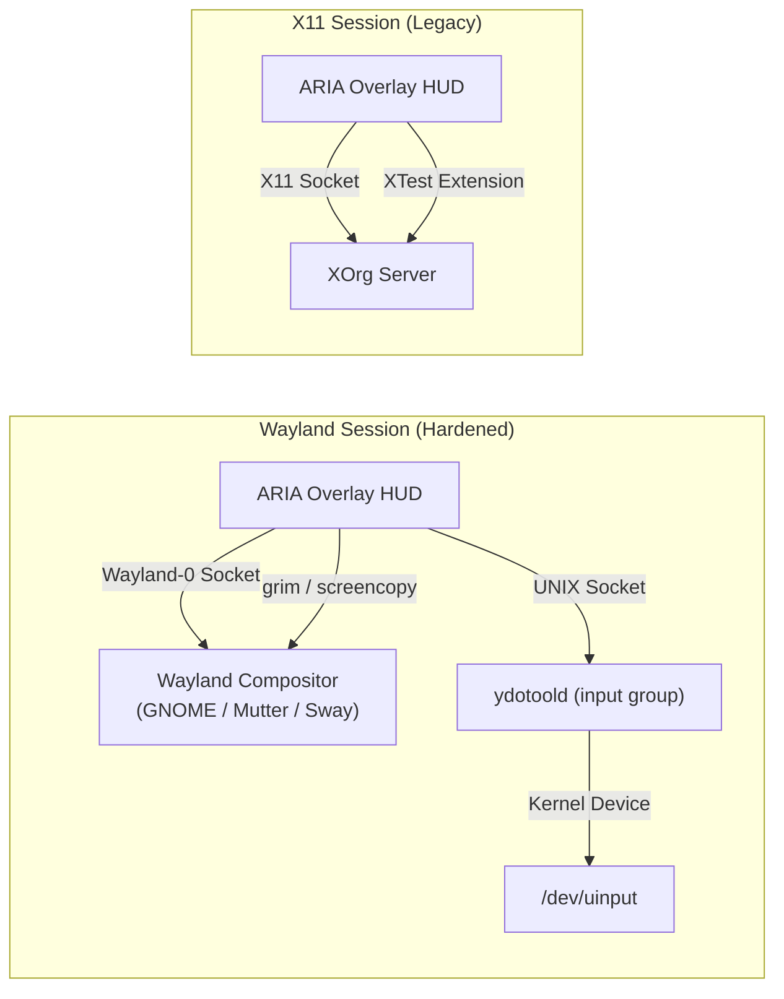

# 🔐 Linux Permissions & Security Architecture

**Document:** System Privileges, Kernel Interfaces, and Permission Architecture  
**Target Environments:** Linux (Ubuntu 22.04+, Debian 12+, Fedora 38+, Arch Linux)  
**Display Protocols:** Wayland (Primary) / X11 (Fallback)  

---

## 1. Fundamental Principle: Zero-Root Principle (Unprivileged Execution)

> [!CAUTION]
> **NEVER RUN ARIA AS ROOT (`sudo aria`):**  
> ARIA is designed from the ground up to execute exclusively within an **unprivileged standard user session** (`UID >= 1000`). Running ARIA as `root` or passing `sudo` to the background daemon bypasses desktop compositor session sockets, invalidates Wayland security boundaries, and exposes your root filesystem to unvetted shell modifications.

ARIA interacts with your system through well-defined, unprivileged POSIX desktop interfaces, local IPC sockets, and user-space systemd units.

---

## 2. Exhaustive Permission Matrix

| Subsystem | Underlying Linux Utility / Driver | Required Permissions / Group | Purpose & Security Boundary |
|---|---|---|---|
| **Input Synthesis (Wayland)** | `ydotool` / `ydotoold` | User in `input` group (`/dev/uinput` rw) | Emulates keyboard keystrokes, mouse movements, and clicks on Wayland without X11 server access. |
| **Input Synthesis (X11)** | `pyautogui` / `XTest` | Standard desktop user | Simulates input via X11 server connection when running under XOrg. |
| **Screen Perception (Wayland)** | `grim` / `gnome-screenshot` | `wlr-screencopy` or GNOME DBus Portal | Captures lossless desktop viewports on demand. Restricted to active session. |
| **Audio Capture** | `sounddevice` / `portaudio` | Access to `/dev/snd/*` or PipeWire/PulseAudio | Captures microphone input during push-to-talk voice recording. |
| **Daemon Orchestration** | `systemd --user` | User Session D-Bus (`systemctl --user`) | Manages background daemon lifecycle (`aria.service`, `ydotoold.service`). |
| **Local IPC Communication** | Unix Domain Socket | Mode `0600` on `~/.aria/aria.sock` | Inter-process signaling between CLI shortcuts, HUD, and background daemon. |
| **Episodic Data Storage** | SQLite & ChromaDB | Mode `0700` on `~/.aria/` | Restricts conversation logs and vector embeddings exclusively to the current user. |

---

## 3. Detailed Setup for Hardware & Kernel Permissions

### A. Wayland Input Control (`ydotool` & `/dev/uinput`)
Wayland security design deliberately prevents normal graphical applications from injecting artificial mouse and keyboard events into other application windows. To automate inputs on Wayland, ARIA utilizes `ydotool` communicating with the kernel's `/dev/uinput` subsystem via a user-level daemon (`ydotoold`).

#### 1. Group Membership
Your Linux user must belong to the `input` group:
```bash
sudo usermod -aG input $USER
```

#### 2. Udev Rule for `/dev/uinput` Access
Modern distributions restrict `/dev/uinput` to root by default. To enable unprivileged access for members of the `input` group, install the following udev rule (handled automatically by `install.sh`):
```bash
echo 'KERNEL=="uinput", GROUP="input", MODE="0660", OPTIONS+="static_node=uinput"' | sudo tee /etc/udev/rules.d/80-uinput.rules
sudo udevadm control --reload-rules && sudo udevadm trigger
```

#### 3. User Daemon Service (`ydotoold.service`)
`ydotoold` runs as an unprivileged user service located at `~/.config/systemd/user/ydotoold.service`:
```ini
[Unit]
Description=ydotool daemon for Wayland input automation
After=graphical-session.target

[Service]
Type=simple
ExecStart=/usr/bin/ydotoold --socket-path /run/user/%U/ydotoold.socket --socket-own %U:input
Restart=on-failure
RestartSec=3

[Install]
WantedBy=default.target
```

---

## 4. Wayland vs. X11 Display Protocol Permissions



- **Under Wayland:** ARIA cannot arbitrarily read keystrokes or mouse clicks destined for other applications. It only receives input when its floating HUD is explicitly focused, and emits inputs via `/dev/uinput`.
- **Global Hotkey Interception:** Registered via GNOME Custom Keybinding schema (`org.gnome.settings-daemon.plugins.media-keys`), allowing GNOME Shell to safely trigger ARIA across all windows without installing global X11 keyloggers.

---

## 5. Destructive Action Defense-in-Depth Protocol

To prevent autonomous AI hallucinations or accidental system corruption, ARIA enforces an interceptor gateway in [aria/utils/confirmation.py](file:///home/itsmeabirmohanta/College%20Coding/Linux-Agent/aria/utils/confirmation.py):

### Intercepted Operations (Require Mandatory Interactive Approval)
1. **System & Administration Commands:**
   - `sudo`, `su`, `pkexec`, `doas`
   - `shutdown`, `reboot`, `systemctl stop`, `init`
2. **Destructive File Manipulation:**
   - `rm`, `rmdir`, `unlink` (targeting directories or system files)
   - `dd`, `mkfs`, `fdisk`, `parted` (disk partition manipulation)
   - Editing `/etc/`, `/boot/`, `/sys/`, `/dev/`
3. **Privilege & Permission Alterations:**
   - `chmod 777`, `chmod -R`, `chown`, `chgrp`
   - Modifying `.bashrc`, `.profile`, `.ssh/authorized_keys`

When any tool attempt matches this threat profile, execution is suspended and a modal dialog appears on your desktop presenting the exact command and arguments for physical confirmation before proceeding.
