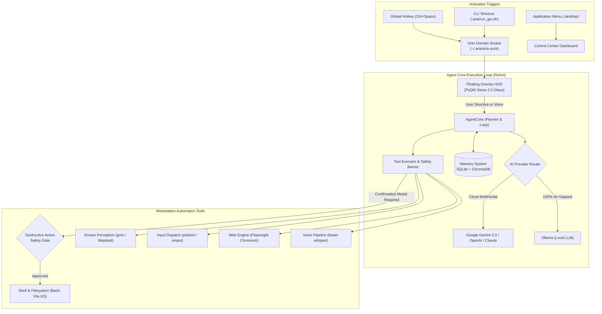

<div align="center">

# ⚡ ARIA — Autonomous Resident Intelligence Agent
### Contemporary Swiss Modernism 2.0 • Local-First • DPDP Compliant • Wayland Native

[](LICENSE)
[](pyproject.toml)
[-090A0D.svg?style=flat-square&logo=linux)](PERMISSIONS.md)
[](PRIVACY_DPDP.md)
[](aria/gui/styles.qss)

<p align="center">
  <b>ARIA</b> is an autonomous AI agent engineered to live silently inside your Linux operating system.<br/>
  Summoned instantly via global shortcut (<code>Ctrl+Space</code>), ARIA perceives your desktop viewports, analyzes code and terminal errors, executes bash automation, automates kernel-level mouse/keyboard input, and navigates browsers autonomously.
</p>

[Quick Start](#-quick-start) •
[Features](#-key-features) •
[Architecture](#-system-architecture) •
[DPDP Privacy](#-dpdp-compliance--data-sovereignty) •
[Permissions](#-linux-permissions--system-security) •
[Documentation](#-documentation--guides)

</div>

---

## 📐 Swiss Modernism 2.0 Design Philosophy

ARIA's interface is built on **Swiss Modernism 2.0** (Contemporary International Typographic Style):
- **Architectural Carbon Canvas:** Deep dark canvas (`#090A0D`, `#111318`) with structured hairline borders (`1px solid #20242D`) and sharp micro-radii (3px–5px).
- **Monospace Telemetry:** High-contrast sans-serif paired with JetBrains Mono data logs (`SYSTEM // 01`, `EXE ➔`, `STATUS: ARMED`).
- **Native Vector Icon Engine:** 25 crisp, theme-aware SVG vector icons rendered at native display DPI without emoji dependencies.
- **Swiss Inversion Actions:** Stark `#FFFFFF` high-voltage buttons transitioning to International Klein Blue (`#0055FF`) on interaction.

---

## ✨ Key Features

| Capability | Subsystem | Description |
|---|---|---|
| **Global Summon** | [hotkey.py](file:///home/itsmeabirmohanta/College%20Coding/Linux-Agent/aria/hotkey.py) | Press **Ctrl+Space** anywhere on Linux to toggle the Spotlight-like floating command HUD. |
| **Multimodal Vision** | [screen.py](file:///home/itsmeabirmohanta/College%20Coding/Linux-Agent/aria/tools/screen.py) | Wayland native screen capture (`grim` / `ImageGrab`) inspecting IDE code, browser viewports, and GUI states. |
| **Hardware Input Takeover** | [input_control.py](file:///home/itsmeabirmohanta/College%20Coding/Linux-Agent/aria/tools/input_control.py) | Kernel-level mouse movement, clicking, dragging, keyboard typing, and hotkeys via `/dev/uinput` (`ydotool`). |
| **Autonomous Browser** | [browser.py](file:///home/itsmeabirmohanta/College%20Coding/Linux-Agent/aria/tools/browser.py) | Playwright Chromium automation: click web elements, fill forms, extract DOM content, and capture web snapshots. |
| **Shell & Filesystem** | [shell.py](file:///home/itsmeabirmohanta/College%20Coding/Linux-Agent/aria/tools/shell.py), [filesystem.py](file:///home/itsmeabirmohanta/College%20Coding/Linux-Agent/aria/tools/filesystem.py) | Native Bash execution, file manipulation, recursive codebase search, and file creation. |
| **Offline Local Voice** | [voice.py](file:///home/itsmeabirmohanta/College%20Coding/Linux-Agent/aria/tools/voice.py) | 100% offline, on-device push-to-talk speech recognition via `faster-whisper` neural network models. |
| **Multi-Provider Brain** | [providers/](file:///home/itsmeabirmohanta/College%20Coding/Linux-Agent/aria/providers/) | Switch seamlessly between **Gemini 2.0**, **OpenAI GPT-4o**, **Claude 3.5 Sonnet**, and **Ollama (Offline)**. |
| **Episodic Vector Memory** | [memory.py](file:///home/itsmeabirmohanta/College%20Coding/Linux-Agent/aria/agent/memory.py) | Dual-tier SQLite relational session history + ChromaDB vector semantic search for contextual recall. |
| **Destructive Action Barrier** | [confirmation.py](file:///home/itsmeabirmohanta/College%20Coding/Linux-Agent/aria/utils/confirmation.py) | Enforces stark modal verification before executing risky commands (`rm`, `sudo`, `dd`, `chmod`). |

---

## 🏗️ System Architecture



---

## 🚀 Quick Start

### 1. One-Shot Automated Installation
Run the installer script in your terminal:
```bash
bash install.sh
```
The installer configures:
- Essential Linux packages (`grim`, `ydotool`, `wl-clipboard`, `libportaudio2`, `ffmpeg`).
- Python virtual environment with all pinned dependencies.
- Playwright Chromium headless/headful browser.
- Systemd user service `aria.service` and `ydotoold.service`.
- GNOME desktop global hotkey registration (`Ctrl+Space`).
- Automatically launches the **Interactive Walkthrough** upon desktop completion!

### 2. Configure Your AI Provider
Copy `.env.example` to `.env` (or configure interactively via the Walkthrough GUI):
```bash
nano .env
```
Choose your provider:
```env
ARIA_PROVIDER=gemini       # Options: gemini | openai | claude | ollama
GEMINI_API_KEY=AIzaSy...   # Free key from Google AI Studio
```

### 3. Launching ARIA
- **Summon Floating HUD:** Press **Ctrl+Space** anywhere on your desktop, or run:
  ```bash
  ~/.aria/run_gui.sh --toggle
  ```
- **Open Control Center Dashboard:** Launch from your Applications menu ("ARIA Control Center") or CLI:
  ```bash
  ~/.aria/run_gui.sh
  ```
- **Open Settings Matrix:**
  ```bash
  ~/.aria/run_gui.sh --settings
  ```
- **Run Interactive Walkthrough Tour:**
  ```bash
  ~/.aria/run_gui.sh --walkthrough
  ```

---

## 🧭 Interactive Auto Walkthrough

When you install ARIA or launch it for the first time, ARIA greets you with an interactive **5-Stage Walkthrough**:
1. **Stage 01 // System Architecture:** Capability manifest with 4 vector capability cards.
2. **Stage 02 // Inference Backend:** Provider selection with a live `VERIFY CONNECTION ➔` latency tester.
3. **Stage 03 // Interaction & Perception:**
   - **Live Hotkey Demo:** Record custom shortcut and click `TRIGGER TEST OVERLAY NOW ➔` to see ARIA slide down live over your desktop.
   - **Live Viewfinder Test:** Click `TEST VISUAL PERCEPTION ➔` to capture a live desktop frame into an architectural viewfinder.
4. **Stage 04 // Security Protocols:** Configure destructive action interception, local voice, and systemd autostart.
5. **Stage 05 // Deployment Armed:** Instant starter missions (*"What is on my screen?"*, *"Run diagnostics"*).

---

## 🛡️ DPDP Compliance & Data Sovereignty

ARIA is designed to be fully compliant with India's **Digital Personal Data Protection Act, 2023 (DPDPA)**, GDPR, and CCPA:

- **Local-First Architecture:** All conversation history, SQLite databases, and ChromaDB vector embeddings are stored strictly locally in `~/.aria/` with POSIX `0700` user permissions.
- **Zero Remote Telemetry:** ARIA contains no phone-home mechanisms, no analytics trackers, and no diagnostic telemetry sent to project maintainers.
- **Ephemeral Processing:** Screen captures and temporary audio recordings are **immediately unlinked and securely deleted** in `finally` blocks upon completion of inference.
- **Air-Gapped Operation:** Supports 100% offline execution via **Ollama** and CPU **faster-whisper** (`0 bytes/sec` external network traffic).
- **Data Principal Rights Built-In:**
  - **Right to Data Portability:** Export your entire session database to JSON (`mem.export_personal_data()`).
  - **Right to Erasure ("Right to be Forgotten"):** 1-click **PURGE ALL MEMORY** in Settings or CLI programmatic wipe (`mem.purge_all_data()`).

For full details, review our legal and technical manifesto: [PRIVACY_DPDP.md](PRIVACY_DPDP.md).

---

## 🔐 Linux Permissions & System Security

ARIA adheres to the **Zero-Root Principle**:
- **NEVER RUN AS ROOT:** ARIA strictly runs as an unprivileged standard user (`UID >= 1000`). Running with `sudo` is unsafe and strictly discouraged.
- **Wayland Input Control:** Operates via kernel `/dev/uinput` through `ydotoold` requiring user membership in the standard `input` group.
- **Wayland Screen Protection:** Uses standard Wayland compositor protocols (`grim` / `wlr-screencopy` / GNOME DBus portals).
- **Destructive Command Interception:** Dangerous bash commands (`rm`, `sudo`, `dd`, `mkfs`, `chmod`) trigger an interactive desktop verification dialog before execution.

For detailed setup of `/dev/uinput`, udev rules, and compositor sandboxing, see [PERMISSIONS.md](PERMISSIONS.md).

---

## 🧪 Testing & Validation

ARIA includes comprehensive unit tests, offscreen GUI layout verifications, and an 8-subsystem standalone simulation:

```bash
# Run Core Unit Tests
.venv/bin/python -m pytest tests/test_agent.py

# Run Offscreen GUI Layout & Vector Icon Tests (25 SVG Icons Verified)
QT_QPA_PLATFORM=offscreen .venv/bin/python tests/test_gui_instantiation.py

# Run 8-Stage Standalone Workflow & ReAct Simulation Loop
.venv/bin/python tests/simulate_full_workflow.py
```

---

## 📂 Documentation & Guides

- [Architecture & Permissions Guide (PERMISSIONS.md)](PERMISSIONS.md) — Kernel drivers, `/dev/uinput`, Wayland security, non-root policy.
- [Digital Personal Data Protection Policy (PRIVACY_DPDP.md)](PRIVACY_DPDP.md) — DPDPA 2023 compliance, data portability, erasure rights.
- [Security Disclosures & Threat Model (SECURITY.md)](SECURITY.md) — Responsible vulnerability reporting and prompt injection defense.
- [Contributing Guidelines (CONTRIBUTING.md)](CONTRIBUTING.md) — Development setup, Swiss Modernism 2.0 design guidelines, PR process.
- [Walkthrough & Verification Log (walkthrough.md)](file:///home/itsmeabirmohanta/.gemini/antigravity-ide/brain/5e79ec91-4bdf-49d7-b2e4-3e61f5fe79a8/walkthrough.md) — Architectural log and subsystem test evidence.

---

## 📜 License

Distributed under the **Apache License, Version 2.0**. See [LICENSE](LICENSE) for the full license text.
